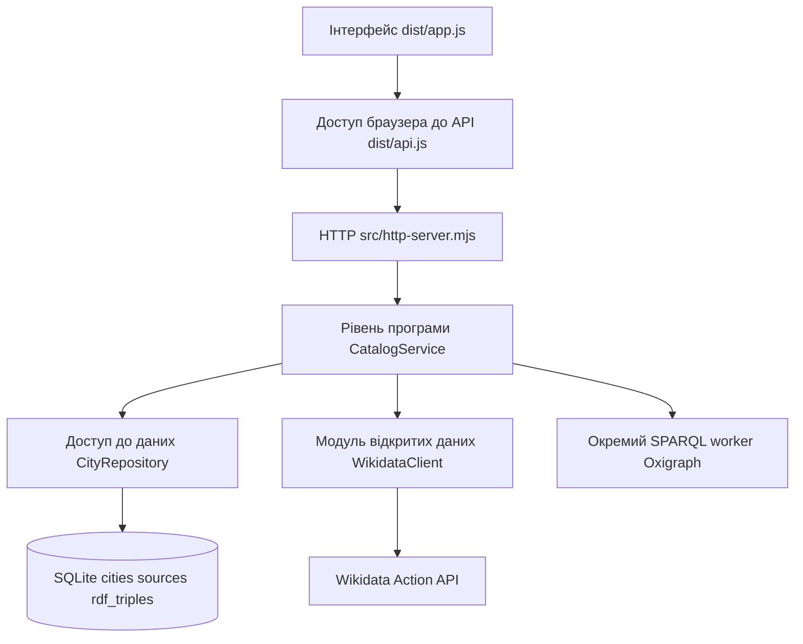

# Архітектура CityGuide UA

CityGuide UA 2 використовує серверну SQLite-базу як спільне джерело даних для сайту. Браузер отримує каталог через API, показує картки та зберігає лише приватне обране. Wikidata завантажується на сервері. SPARQL виконується на сервері над RDF-трійками, прочитаними з SQLite.

## Програмні рівні

| Рівень          | Відповідальність                                | Файли                                                   |
| --------------- | ----------------------------------------------- | ------------------------------------------------------- |
| Сховище         | Постійні міста, джерела, RDF та версія імпорту  | `data/cityguide.sqlite`                                 |
| Доступ до даних | SQL-запити, транзакції, резервування            | `src/data/city-repository.mjs`                          |
| Програма        | Імпорт, оновлення, узгодженість даних, SPARQL   | `src/services/catalog-service.mjs`                      |
| Інтерфейс       | HTTP API і браузерні картки                     | `src/http-server.mjs`, `dist/app.js`, `dist/index.html` |
| Відкриті дані   | Wikidata, тайм-аут, пакетні запити, конвертація | `src/open-data/wikidata-client.mjs`, `dist/core.js`     |

`dist/api.js` відокремлює HTTP і localStorage від DOM. `dist/core.js` містить спільні чисті функції: перевірка доменних записів, ранги тверджень, дати, пошук і RDF-серіалізація. Відображення та локальне сортування можуть виконуватися в браузері; персистентність і SPARQL належать серверу.

## Схема бази

- `cities`: нормалізовані міста з QID, координатами, датованим населенням та редакцією джерела.
- `source_entities`: сирі JSON-сутності, отримані під час живих імпортів, зі зв’язком на місто. Початковий seed містить нормалізовані дані та provenance, тому сирі JSON для нього з’являються після першого успішного оновлення.
- `rdf_triples`: унікальні трійки з subject, predicate та object у синтаксисі N-Triples. Індекси за subject/predicate/object і predicate/object.
- `catalog_state`: версія графа та час останнього успішного імпорту.

Схема має версію `PRAGMA user_version=1`. База працює з WAL, foreign keys і busy timeout. Перший запуск наповнює порожню БД з `dist/cities.json`. Наступні запуски читають існуючу БД і не замінюють її початковими 12 містами.

## Узгодженість та розширення

Імпортер підтримує нові QID, а не тільки перелік seed. Клієнт отримує дані пакетами по 50 QID. Повна валідація виконується до запису. Одна SQL-транзакція додає або оновлює міста, джерела, RDF-проєкцію та номер версії. Помилка на будь-якому кроці виконує ROLLBACK. Міста поза поточним імпортом залишаються в БД.

Під час оновлення RDF-проєкція перебудовується для всього каталогу. Це проста узгоджена реалізація для навчального каталогу, а не інкрементальний механізм обробки мільйонів трійок. SQLite підходить для одного екземпляра застосунку; для паралельних серверів або значно більших графів потрібні PostgreSQL чи спеціалізоване RDF-сховище та зміна реалізації репозиторію.

SPARQL запускається в окремому Worker з обмеженням часу 5 секунд і JS heap 128 МБ. Це не є повним лімітом усієї пам’яті процесу: WebAssembly має власну пам’ять. Одночасно виконується один запит, зовнішній SERVICE вимкнено, інтерфейс приймає SELECT і показує до 200 рядків. Для дуже великих проміжних результатів потрібні додаткові обмеження спеціалізованого рушія. Складний запит не виконується в HTTP event loop.

## API

| Метод і шлях        | Дія                                                |
| ------------------- | -------------------------------------------------- |
| `GET /api/cities`   | Поточний каталог, його версія та розмір графа      |
| `POST /api/refresh` | Оновлення всіх QID, які вже зберігаються в БД      |
| `GET /api/graph`    | Експорт саме збереженого RDF-графа                 |
| `POST /api/query`   | JSON `{ "query": "SELECT ..." }`, обмежений SPARQL |
| `GET /healthz`      | Перевірка HTTP-сервера та доступності SQLite       |

Оновлення має загальний cooldown 60 секунд. Нові довільні QID додає адміністратор командою імпорту, а не відвідувач через публічний API. Обране залишається локальним для браузера: користувацькі облікові записи до цього релізу не входять.
