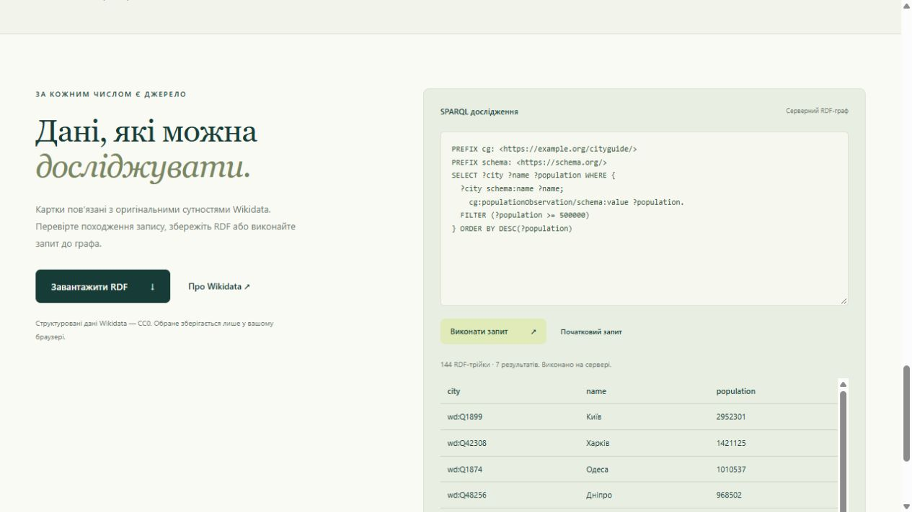

# Результати перевірки CityGuide UA 2

Перевірено 06.11.2026 у Windows з Node.js 24.22.1 і SQLite 3.53.4.

`npm run check` пройшов: правила ESLint і форматування Prettier узгоджені. `npm run test:coverage` завершився з результатом **28 passed, 0 failed**. Перший запуск HTTP-тестів у середовищі з обмеженням локальних з’єднань отримав EACCES; після надання доступу до localhost повний набір завершився успішно.

| Перевірка                                                | Результат |
| -------------------------------------------------------- | --------- |
| Перезапуск SQLite зі збереженням 13-го тестового запису  | Пройшла   |
| Незмінність даних при помилці посеред SQL-транзакції     | Пройшла   |
| Узгоджена резервна копія SQLite                          | Пройшла   |
| Відмова Wikidata без втрати каталогу                     | Пройшла   |
| Збереження сирих джерел Wikidata                         | Пройшла   |
| Серверний SELECT, відмова для SERVICE та тайм-аут Worker | Пройшла   |
| HTML, JS/WASM MIME, HEAD, 404 та захист шляху до файлів  | Пройшла   |
| API каталогу, RDF-завантаження та SPARQL                 | Пройшла   |
| Некоректний і завеликий JSON                             | Пройшла   |
| Вимога постійного диска Railway                          | Пройшла   |

Node coverage для власних модулів, **завантажених тестами**: 89,57% рядків, 75,83% гілок, 90,91% функцій. Сторонній Oxigraph і самі тести виключені з цього підсумку. Браузерні app.js та api.js не виконуються Node-тестами, тому це не відсоток покриття всього вебзастосунку. Модуль CityRepository має 100% покриття рядків у цьому запуску.

Окремо через справжній браузер перевірено каталог із SQLite, Unicode-пошук ЛЬВІВ, обране, картку міста, живе оновлення Wikidata та серверну вибірку на 7 міст. Після завершення сервера повторне відкриття файла БД підтвердило 12 міст, 144 трійки, версію імпорту 2 та наявність збереженого JSON-джерела Києва.

Docker локально відсутній. Налаштування GitHub і Railway не змінювались. Збірку контейнера, реальний GitHub check та поведінку Volume після deploy потрібно підтвердити після публікації у відповідних сервісах; кроки збірки й перевірки контейнера вже включені в CI.
